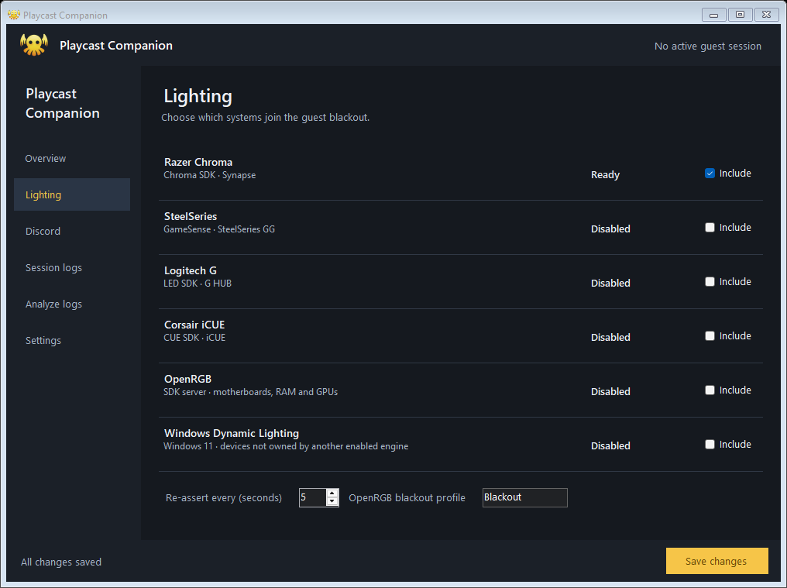
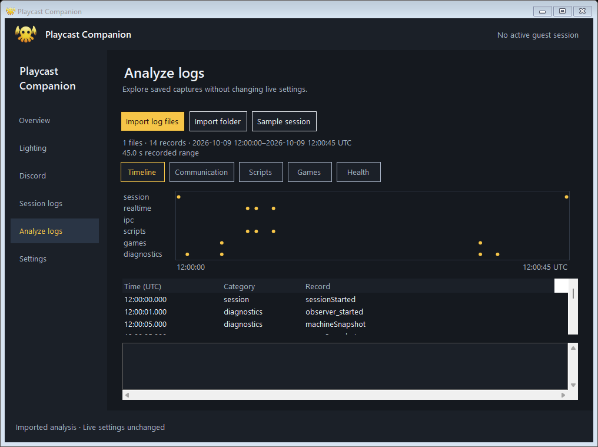

# Playcast Companion

> **Unofficial.** A personal, open-source Windows utility for people who host
> cloud-gaming sessions with Playcast. It is not affiliated with, endorsed by, or
> supported by Playcast or any hardware vendor named below.

While a guest account is signed in to your PC, Playcast Companion makes the
machine look neutral: **every RGB lighting ecosystem you enable goes dark**, and
(optionally) **your Discord profile shows that you're hosting**. The moment the
guest session ends, everything hands back — Synapse/iCUE/GG profiles return and
the Discord status clears.

**Downloads:** [regular 2.5.1](https://github.com/TypicalTitan/PlaycastCompanion/releases/tag/v2.5.1)
and [Native 3.2.3](https://github.com/TypicalTitan/PlaycastCompanion-cpp/releases/tag/v3.2.3).
Both include the sidebar, session logger and local log analyzer. Choose one:
they use the same installation folder and compatible configuration.

- Detects the guest session through Windows WTS notifications. Full realtime
  capture optionally consumes a diagnostic feed from an instrumented Playcast host.
- Lighting: **Razer Chroma**, **SteelSeries GameSense**, **Logitech G**,
  **Corsair iCUE**, **OpenRGB** (motherboards, RAM, GPUs…), and **Windows
  Dynamic Lighting**, each individually selectable and safe to run together.
- Discord Rich Presence with an optional "Hosting *{game}* in Nonsole Mode" line.
- Automatic session logs with local game/process snapshots and an optional
  Playcast diagnostic feed for complete realtime messages and PowerShell deployments.
- A resizable sidebar window with compact lighting rows, Save/Discard, and
  local JSONL import with timeline, communication, scripts, games and health views.
- Runs unelevated, starts with Windows for every account, headless in the guest
  session, dark-themed settings window in yours.

## Requirements

| Need | Notes |
|---|---|
| Windows 11 (Windows 10 2004+ works; Dynamic Lighting needs Win11) | x64 |
| To **run** a release build | Nothing else — releases are self-contained. |
| To **build** | [.NET 10 SDK](https://dotnet.microsoft.com/download) |
| To build the **installer** (optional) | [NSIS 3.x](https://nsis.sourceforge.io/) |
| For each lighting ecosystem | That vendor's software running (Synapse, GG, G HUB, iCUE, OpenRGB) — see *Lighting engines* |
| For Discord | Discord desktop running, plus your own (free) Discord Application ID |

## Build — step by step

1. **Install the .NET 10 SDK** (one line, admin prompt):
   ```powershell
   winget install Microsoft.DotNet.SDK.10
   ```
   Verify: `dotnet --version` prints `10.x`.

2. **Clone and build:**
   ```powershell
   git clone https://github.com/TypicalTitan/PlaycastCompanion.git
   cd PlaycastCompanion
   dotnet build -c Release
   ```
   Run from `bin\Release\net10.0-windows10.0.22621.0\PlaycastCompanion.exe`.
   The first `dotnet build` restores the Windows SDK projection package
   automatically (needs internet once).

3. **Make a single self-contained exe** (no .NET runtime needed on the target):
   ```powershell
   dotnet publish -c Release -r win-x64 --self-contained true -p:PublishSingleFile=true -p:EnableCompressionInSingleFile=true -o installer\payload
   ```

4. **(Optional) Build the installer:**
   ```powershell
   winget install NSIS.NSIS
   installer\build-setup.cmd
   ```
   Produces `installer\PlaycastCompanionSetup-<version>.exe`. The script runs
   step 3 and the NSIS compile for you and fails loudly if anything is missing.

**Releasing:** build release binaries from a *clean clone*, never from a working
tree that has local `Assets/brands` art — local art is embedded into local builds
by design, and must not ship.

CI does steps 1–3 on every push (`.github/workflows/build.yml`) and uploads the
payload as an artifact, so a green check means the repo builds from scratch.

## Install

Run the setup (one UAC prompt; silent `/S` supported). It:
- installs to `%ProgramFiles%\PlaycastCompanion` (fixed path; standard users —
  including the guest account — can only read it);
- enables autostart for **every** account via `HKLM\…\Run` (passes
  `--autostart`, so logon starts are silent);
- adds a Start Menu shortcut and a Settings → Apps entry with a real uninstaller;
- preserves your `config.json` across upgrades.

Uninstall from Settings → Apps. It stops all instances, removes autostart
entries, the Apps entry, the install folder (guarded: only if it actually
contains `PlaycastCompanion.exe`), and the current user's log folder.

## First run

1. Launch it (Start Menu, or the exe). A dark settings window opens; the tray
   icon is the app mark — bright when idle, dimmed while a guest is hosting.
2. **Settings → Guest account name**: the Windows account your host signs
   guests into (default `NonsoleMode`). Case-insensitive.
3. **Lighting**: include the ecosystems you own.
4. **Discord** (optional): see *Discord* below.
5. **Save**. Lighting and Discord toggles apply immediately; account/registry
   changes take effect on restart (the app offers one).
6. **Overview → Preview guest mode (10 s)** runs the full effect so you can
  see it without a real guest.

## Sidebar and log analysis

Overview shows the actual guest and integration state. Lighting uses six
consistent rows; Discord, Session logs and Settings keep their own controls.
Save remains visible on settings pages, and Discard restores pending edits.
Analyze logs leaves live settings unchanged.




Open **Analyze logs → Import log files** for one or more `.jsonl`, `.ndjson`
or `.log` files, including rotated category files. **Import folder** reads a
session folder and its subfolders; files/folders can also be dropped onto the
analyzer. **Sample session** loads synthetic data. Parsing runs in the background
and never uploads logs or executes captured scripts.

| View | What it shows |
|---|---|
| Timeline | Stored records on a UTC category timeline, plus a selectable record list. |
| Communication | Realtime and IPC messages with complete available payloads. |
| Scripts | Linked deployment phases, status, observed runtime, script text, stdout/stderr and exit codes. Matching dedicated/realtime copies count once. Native phases without a shared identifier remain separate; launch acceptance is distinct from completion. |
| Games | Latest passive installed inventory, matched running games/processes, and source coverage. |
| Health | Companion working set (MiB), cumulative CPU time (seconds), and capture failures. Missing measurements remain unavailable. |

Select a row or plotted point to inspect the source filename/line and JSON.
The inspector limits its preview to 100,000 characters. Imports are bounded to
128 MiB, 50,000 valid records, 10 MiB per line and 5,000 selected files.
Invalid/unreadable records produce warnings while valid records remain usable;
an import with no valid records retains the previous view. Records captured
with secrets enabled are explicitly flagged. Game inventory is an observed
snapshot at its recorded time, not a claim about the machine's current state.

## How it works

A hidden window registers `WTSRegisterSessionNotification(NOTIFY_FOR_ALL_SESSIONS)`.
On every logon/logoff/connect/disconnect (plus a 30 s safety poll and once at
startup) it enumerates sessions and asks *does the guest account have one?* When
yes, each enabled lighting backend starts a hold loop (connect → assert black →
heartbeat/re-assert every few seconds; retry quietly every 30 s if the vendor
software isn't there) and Discord presence goes live. When no, every backend
releases and the presence clears. Everything degrades gracefully — a missing
SDK or a closed Discord is a status line, never an error dialog.

Two instances coexist by design (one per Windows session, `Local\` mutex): the
one in the guest session runs **headless** — no tray icon, no window, nothing
for a guest to click — and holds the blackout independently of the one in your
session.

## Session logs

Logging starts automatically when the configured guest account signs in and
closes when its session ends. Each observed Windows guest session gets a new
folder under `%LOCALAPPDATA%\PlaycastCompanion\sessions`. Starting Companion
during a session records the remaining portion; events before startup are
unavailable. A Companion restart creates another log segment.

Use **Session logs** in settings to see capture status, open the folder, set
the snapshot interval, or disable automatic logging. The **Debug: include
credentials and tokens** checkbox immediately changes the policy for new
records; previously written records retain their original contents. This debug
toggle is process-local and resets after restart. Secrets are redacted by default: credential
fields, nested JSON, bearer tokens, JWTs, private keys and common PowerShell
secret assignments/arguments. Redaction is best effort for arbitrary script
text or output; avoid sharing raw debug logs without reviewing them.

Files contain one timestamped JSON object per line:

| File | Contents |
|---|---|
| `session.jsonl` | Start/end, Windows session identity and capture policy changes. |
| `realtime.jsonl` | Realtime WebSocket messages and host HTTP requests/responses, including authentication and provisioning. |
| `ipc.jsonl` | Host/native messages visible through the Electron IPC boundary. |
| `scripts.jsonl` | PowerShell deployment bodies, started/result/revoke events, stdout/stderr, exit status and execution IDs. |
| `games.jsonl` | Installed/running game snapshots and Playcast game catalog/launch state. |
| `diagnostics.jsonl` | Connection transitions, host/matchmaking/driver/display state, resource snapshots, Companion backend status and capture failures. |

**Full realtime and script capture requires the Playcast host diagnostic hook.**
Rebuild both `host-frontend` and `host-electron` from `playcast-apps-1` with
the hook included; a stock Playcast release does not expose that feed. The hook
source is pushed as an [applyable patch](https://github.com/TypicalTitan/playcast-apps/tree/codex/companion-session-diagnostics)
in the personal Playcast repository.
The guest host sends an ACL-protected, local named-pipe feed to the Companion
instance in the owner's account. Keep owner Companion running for realtime
capture. The headless guest instance records its own machine snapshots in
the guest profile; it reports that realtime capture belongs to the owner.
The logger accepts diagnostic data only and never executes captured scripts.
Feed frames are bounded to 1 MiB. Oversized traffic and unreadable or binary
HTTP request bodies produce drop/omission markers rather than partial scripts.

Local inventory resolves the configured guest account's current SID and Windows
profile, including suffixes such as `NonsoleMode.000`. Steam starts at that
profile's `AppData\Local\Playcast\Steam` and follows its library manifests and
guest registry entries. Epic uses guest-registered manifests and Legendary's
guest `installed.json`; unrelated owner installations in shared Epic metadata
are excluded. Junctions are resolved for running-process matching. Protected
guest files produce explicit coverage gaps, and the owner's library is never
substituted for unreadable guest inventory. It does not claim to cover GOG, Xbox, EA, Ubisoft or standalone
games without a Playcast catalog entry. Running-game detection matches
executables under known install roots in the target Windows session, and
records access failures and unknown coverage. Playcast's game launch state
and running-window list are additional signals, not proof that every game
process was observed.

Snapshots run every 30 seconds by default. Each session also gets a bounded final
snapshot (`phase: sessionEnd`) after backend cleanup, including sessions shorter
than the normal interval. Failed or timed-out capture records unknown inventory
and fresh Companion resource observations. Inaccessible Playcast processes remain
listed with unavailable metrics and partial process coverage. Chroma cleanup
reports the actual HTTP outcome, and Dynamic Lighting cancellation/retries retain
at most one pending operation.

Companion cannot switch on development-only native Playcast log files in stock
Release binaries. PlaycastService, Playjector, PlayjectorHelper and
ElevationPolicyAgent skip file-logger initialization in Release, and shared
Warning/Info/Debug log calls are compiled out. Full native diagnostics requires
updated Playcast binaries with a separate logging-only runtime control. The
Companion secrets checkbox changes captured-record redaction; it does not enable
those native loggers or developer mode.

Category files rotate at 10 MiB;
each session is capped at 100 MiB, with an explicit limit marker when capture
stops. Expired generated session folders are removed after 14 days when a
new session starts. Session folders permit only their owner and SYSTEM;
logs stay on the PC. `SessionLogging` in `config.json` controls these defaults.

Contract checks run without test packages:

```powershell
dotnet run --project Tests/PlaycastCompanion.ContractTests.csproj -c Release
```

## Lighting engines

| Engine | Talks via | Needs | Notes |
|---|---|---|---|
| Razer Chroma | REST `localhost:54235` | Razer Synapse | Session heartbeat < 15 s; re-asserts so Synapse can't fight back. Released = Synapse profile returns. |
| SteelSeries GameSense | REST (address from `coreProps.json`) | SteelSeries GG | Binds one colour handler per device type, independently. |
| Logitech G | LED Illumination SDK (DLL) | G HUB, or `LogitechLedEnginesWrapper.dll` beside the exe | True save/restore. DLL is **not** bundled. |
| Corsair iCUE | CUE SDK v3 (DLL) | `CUESDK.x64_2017.dll` beside the exe | Exclusive control while held. DLL is **not** bundled. |
| OpenRGB | TCP SDK server `:6742` | OpenRGB running as server | Saves your lighting to a restore profile, loads your all-black profile (create one named `Blackout`), swaps back on release. |
| Windows Dynamic Lighting | WinRT `LampArray` | Win11 + LampArray devices | **Skips devices an enabled vendor engine already owns** (e.g. Razer gear, which Razer surfaces to WDL), so engines never fight. Disable with `DynamicLighting.ExcludeVendorOwnedDevices`. |

Every other engine only ever touches its own vendor's devices, so they all run
side by side.

## Discord

1. Create a free application at <https://discord.com/developers/applications>.
   Its **name** renders as "Playing …".
2. Put its **Application ID** into `config.json` → `Discord.ApplicationId`
   (deliberately config-file-only; not editable in the UI).
3. Optionally upload an image as a **Rich Presence → Art Asset** with the key
   in `Discord.LargeImageKey`.

The two status lines are editable on the Discord tab, with a live preview.

### Game pass-through (optional, default OFF)
Can turn the line into **"Hosting Fortnite in Nonsole Mode"**. A shim in the
guest session offers a Discord-compatible IPC endpoint on `discord-ipc-1..9`
(never `-0`, so it cannot interfere with your real Discord); a game the guest
launches may connect, the shim reads only its **Application ID** from the
handshake (rich-presence frames are discarded) and relays it over an ACL'd,
caller-verified pipe to your session, which resolves the name via Discord's
public app registry (cached) and fills `HostingTemplate`.

**Known limitation, by design:** the pipe namespace is machine-global and your
real Discord owns `discord-ipc-0`, whose permissions deny the guest account. A
game that is denied there and *gives up* (Discord's canonical native library
does) never reaches the shim — it isn't captured and the static line is shown.
Games whose client advances past a denied slot are captured. Validate against
your own games: the log shows `Shim: game connected … client_id …` or a
`no game has connected yet` heartbeat.

## Configuration

`config.json` next to the exe (comments allowed). All values are validated and
clamped on load. Most are editable from the window.

| Key | Default | Meaning |
|---|---|---|
| `TargetUsername` | `NonsoleMode` | Guest account whose session triggers stealth mode. |
| `TickSeconds` | `5` | Chroma heartbeat/re-apply cadence (1–10). |
| `RetryInitSeconds` | `30` | Retry interval when a vendor API is unreachable. |
| `IncludeDisconnectedSessions` | `true` | A disconnected-but-signed-in guest still counts. |
| `ChromaInitUrl` | `http://localhost:54235/razer/chromasdk` | Must be a loopback URL. |
| `RazerEnabled`, `SteelSeries.Enabled`, `Logitech.Enabled`, `Corsair.Enabled`, `OpenRgb.Enabled`, `DynamicLighting.Enabled` | Razer `true`, others `false` | Which engines join the blackout. |
| `OpenRgb.Host` / `.Port` / `.BlackoutProfile` | `127.0.0.1` / `6742` / `Blackout` | OpenRGB server and the all-black profile to load. |
| `DynamicLighting.ExcludeVendorOwnedDevices` | `true` | Don't double-drive devices a vendor engine owns. |
| `Discord.Enabled` / `.ApplicationId` / `.Details` / `.State` / `.LargeImageKey` / `.LargeImageText` | — | Rich Presence settings. |
| `Discord.GamePassthroughEnabled` / `.HostingTemplate` / `.ShimFallbackGame` / `.ShimPipeName` | `false` / `Hosting {game} in Nonsole Mode` / … | Game pass-through. |
| `RegistryWatch.*` | disabled | Optional extra guest-mode signal (a registry value Playcast writes while a guest display is up), ORed with session detection. |

## Security model

- Binary and config under Program Files (admin-write-only); autostart in HKLM —
  the guest account can't replace the exe, edit settings, or disable autostart.
- The app never runs elevated; install/uninstall/config-save each take one UAC.
- Fail-safe restore: Chroma drops a session that stops heartbeating for ~15 s,
  Discord clears an activity when its pipe closes — lights and profile come
  back even after a hard kill.
- Unhandled exceptions are logged (`%LOCALAPPDATA%\PlaycastCompanion\playcast-companion.log`),
  never shown as dialogs a guest could see.
- The relay pipe is ACL'd to the guest account and re-verifies the caller, so
  no other local process can inject a game name into your Discord.
- All config strings are sanitized and length-capped; the Chroma URL must be
  loopback.

## Dev harness flags

- `--snapshot <dir>` renders all sidebar pages to PNG without starting lighting,
  Discord or capture. Add `--snapshot-log <file>` to render all five analyzer
  views against a capture.
- `--lamps [file]` lists every LampArray device the OS exposes and whether the app can drive it.
- `--autostart` quiet start (used by the Run key); a second manual launch just
  raises the running instance's window.

## Legal & trademarks

This repository contains **no** vendor logos, fonts, or Playcast artwork — the
cards use original drawn marks and plain brand names/colours. Product names are
used only to identify interoperability; see `THIRD_PARTY_NOTICES.md`. If you
want real brand art in *your* build, `Assets/brands/README.md` explains the
gitignored drop-in (you are responsible for having the right to use it).

Integrating this into a product? See `INTEGRATION.md`.

## License

MIT — see `LICENSE`.
